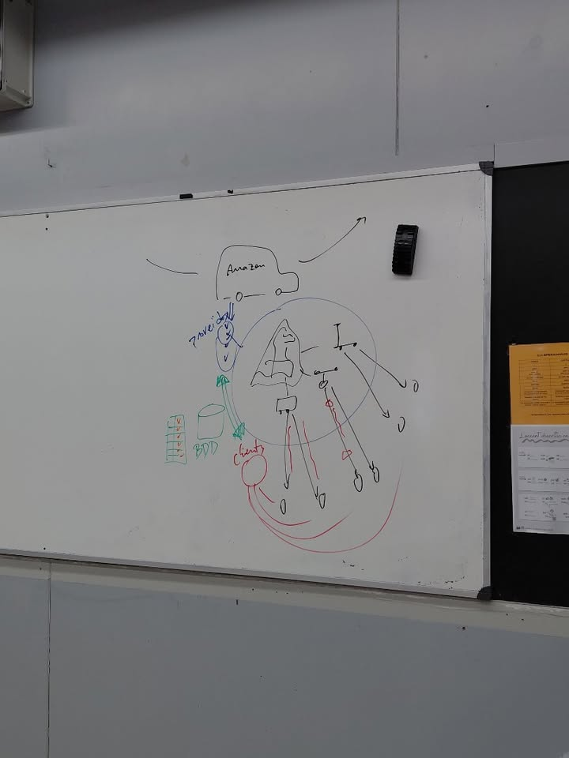
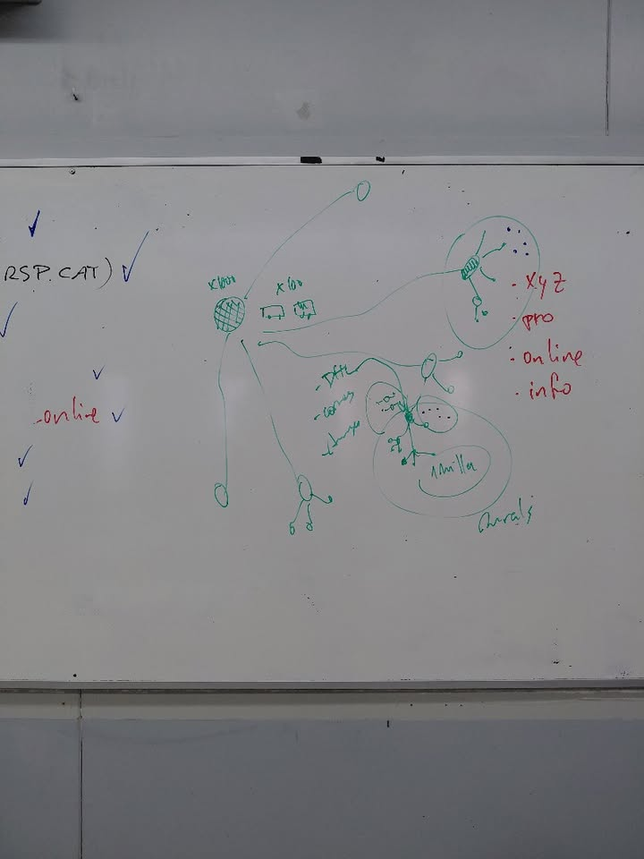

# Projecte intermodular PackGo
## Idea principal del projecte
La idea principal del meu projecte és crear una empresa de repartiment de paquets per als pobles, perquè penso que podria ser molt útil tant per a les grans empreses de repartiment com per als habitants dels pobles. D'aquesta manera, es podrien evitar alguns problemes relacionats amb el repartiment. Les grans empreses tenen molts problemes a l'hora de repartir paquets en pobles petits, ja que han de fer molts desplaçaments i perdre molt de temps per entregar pocs paquets. Amb aquest projecte, vull fer que el repartiment sigui més fàcil, rapid i economic. Així poder evitar problemes o retards per part de les empreses. Avui en dia tothom compra paquets a internet que han de rebre a casa, per tant serà una empresa amb una idea molt útil i utilitzable per a tothom.

## La meva proposta
La meva proposta seria crear un punt de repartiment a cada poble, on les grans empreses deixarien tots els paquets en aquell poble. Les empreses deixarien els paquets en aquest punt i nosaltres ens encarregaríem de repartir-los per tot el poble. Tindríem diferents opcions, com per exemple treballadors amb patinets elèctrics per als paquets més petits, cotxes o furgonetes per als paquets més grans i també podríem utilitzar drons per fer alguns repartiments, pero encara s'han de fer proves.

## Com guanyarem diners
Així, les grans empreses no haurien de perdre tant de temps repartint els paquets poble per poble i nosaltres podríem cobrar una quantitat per cada paquet que repartíssim. Gràcies a això, podríem aconseguir que els repartiments fossin més ràpids i eficients, estalviar temps a les grans empreses i fer que els habitants dels pobles rebessin els seus paquets més ràpidament.

## Objectius del projecte
- Millorar el sistema de repartiment de paquets als pobles.
- Ajudar les grans empreses a estalviar temps i diners.
- Aconseguir que els paquets arribin als clients més ràpidament.
- Evitar problemes i retards en els repartiments.
- Treballar amb diferents empreses de repartiment.
- Oferir els nostres serveis a molts pobles.
- Utilitzar vehicles elèctrics com els patinets per reduir la contaminació.
- Tenir un bon servei tant a les empreses com als clients.
- Fer que els repartiments siguin més bons i sostenibles.

## Esquemes del projecte
Aquí adjuntaré un parell d'esquemes del meu projecte.

 

 
