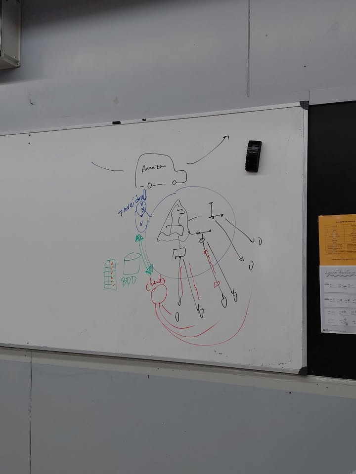
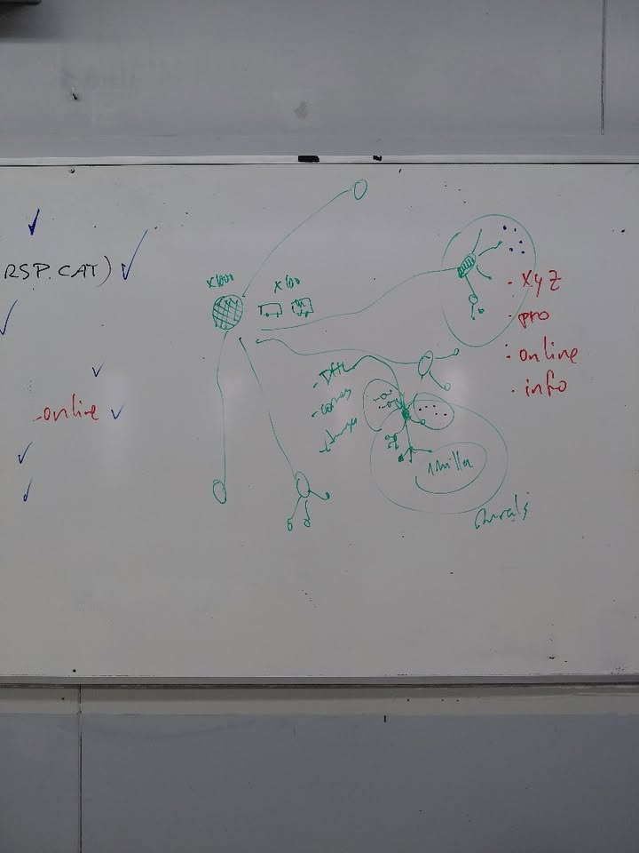

# Projecte intermodular PackGo
## Context del projecte
La idea principal del meu projecte és crear una empresa de repartiment de paquets per als pobles, que es dirà PackGo. Aquesta empresa formaria part del sector del transport i la logística i estaria pensada per ajudar les grans empreses de repartiment i els habitants dels pobles.
He pensat en aquesta idea perquè les grans empreses tenen molts problemes a l'hora de repartir paquets en pobles petits, ja que han de fer molts desplaçaments i perdre molt de temps per entregar pocs paquets. Avui en dia, molta gent compra per internet i rep paquets a casa, per tant, crec que podria ser una empresa molt útil.
El projecte consisteix a crear un nou sistema de repartiment que faci que els lliuraments siguin més fàcils, ràpids i econòmics. També es podria utilitzar un sistema informàtic per ajudar a organitzar els paquets i controlar els repartiment
## Descripció general del sistema
La meva proposta seria crear un punt de repartiment a cada poble, on les grans empreses deixarien tots els paquets destinats als habitants d'aquell poble. A partir d'aquest punt, nosaltres ens encarregaríem de repartir-los per tot el poble.
D'aquesta manera, les grans empreses no haurien de perdre tant de temps anant poble per poble per entregar pocs paquets, ja que nosaltres ens encarregaríem de fer l'última part del repartiment. Així podríem aconseguir que els paquets arribessin als clients més ràpidament i evitar alguns problemes o retards.
Per fer els repartiments, tindríem diferents opcions segons la mida dels paquets. Per exemple, podríem utilitzar patinets elèctrics per als paquets més petits i cotxes o furgonetes per als paquets més grans. També podríem estudiar la possibilitat d'utilitzar drons per fer alguns repartiments, però abans s'haurien de fer proves per veure si és possible.
Els principals usuaris del sistema serien les grans empreses de repartiment, que ens portarien els paquets, i els habitants dels pobles, que els rebrien a casa seva. Els treballadors de PackGo s'encarregarien de rebre els paquets, organitzar-los i repartir-los als seus destinataris.
També podríem utilitzar un sistema informàtic per tenir els paquets més controlats, saber a qui pertany cada paquet i organitzar millor els repartiments.
La manera de guanyar diners seria cobrar una quantitat per cada paquet que repartíssim. Així, les grans empreses podrien estalviar temps i diners i nosaltres obtindríem ingressos pel nostre servei.
Els objectius principals de PackGo serien millorar el repartiment de paquets als pobles, ajudar les grans empreses a estalviar temps i diners, evitar retards, treballar amb diferents empreses de repartiment i utilitzar vehicles elèctrics per reduir la contaminació
## Abast del sistema
En aquest projecte, em centraré principalment a explicar com funcionaria l'empresa PackGo i com s'organitzaria el repartiment de paquets als pobles.
El projecte inclourà la creació dels punts de repartiment, la recepció dels paquets de les grans empreses, l'organització dels paquets i el seu repartiment als clients. També es tindrà en compte quins vehicles es podrien utilitzar segons la mida dels paquets i com es podria organitzar la feina dels treballadors.
A més, es podria estudiar la utilització d'un sistema informàtic per controlar els paquets i facilitar l'organització dels repartiments.
En canvi, en aquest primer projecte no es crearà una gran empresa que reparteixi per tots els pobles ni es desenvoluparà un sistema informàtic professional complet. La idea és començar amb un poble i, si el sistema funciona bé, ampliar el servei a altres pobles més endavant.
L'ús de drons tampoc formaria part del funcionament inicial, ja que primer s'hauria d'estudiar si són una bona opció i si es poden utilitzar legalment.
En el futur, es podrien afegir més pobles, treballar amb més empreses de repartiment i crear una aplicació informàtica per controlar millor els paquets. Aquestes parts es podrien desenvolupar més endavant o amb l'ajuda d'altres empreses especialitzades.
L'objectiu inicial és veure si la idea de PackGo pot funcionar i aconseguir que el repartiment de paquets als pobles sigui més ràpid, econòmic i eficient.

## Esquemes del projecte
Aquí adjuntaré un parell d'esquemes del meu projecte.

 

 
